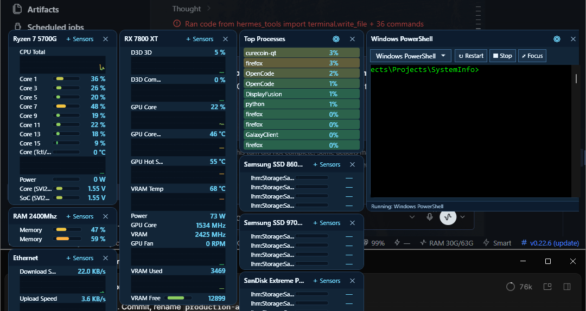

# SystemInfo

SystemInfo is a lightweight, always-on desktop hardware monitor for Windows: a frameless, always-on-top widget you arrange into boxes, one per component instance, with live sensor values, color-coded bars and per-sensor history graphs. It was built from scratch because the hardware-monitor gadget that shipped with Windows 7 was abandoned along with the sidebar platform, leaving no maintained desktop equivalent.

Data comes **only from [LibreHardwareMonitor](https://github.com/LibreHardwareMonitor/LibreHardwareMonitor)** (`LibreHardwareMonitorLib`, the maintained successor to OpenHardwareMonitor). Every row you see is a live LHM sensor — no built-in or synthetic sections exist.

## Screenshot

<picture>
  
</picture>

## Features

- **One box per hardware instance.** CPU, each GPU, memory, motherboard, storage (per drive), network adapters and more — each LHM hardware instance gets its own box, titled from the detected hardware (e.g. `Ryzen 7 5700G`, `RAM 2400Mhz`, `Samsung SSD 860 EVO 500GB`). Double-click a title to rename it; use **Reset to automatic title** to re-derive it.
- **First-run stock layout.** On a fresh machine, SystemInfo builds a reference nine-box arrangement (CPU, GPU, storage, network, memory, processes, embedded terminal) sized and titled for the hardware actually present — nothing is hard-coded to the developer's PC. After the first run, boxes are only ever added by you (`+ Add`).
- **Per-sensor graphs.** Any sensor can be graphed (time-varying categories only). Bars are color-coded with a good/bad direction resolved per sensor (high is good for `Memory Available`, low is good for `Temperature`, etc.); values render as `—` instead of `NaN` when a sensor has no reading.
- **Drag, resize, snap.** Boxes snap to each other with a 4px gap; the window is draggable, resizable and always-on-top by default.
- **Right-click quick actions.** Lock window/boxes, keep on top, Font/Bar/Graph scaling (5 sizes each), Add box, Settings.
- **Settings window.** Persisted display and deep configuration: scaling, locks, `Hide Background` (hides window chrome when the mouse leaves the window), background image with opacity/saturation/brightness, refresh cadence (Normal 1000 ms · Eco 2000 ms · Fast 500 ms · Fastest 250 ms), optional GitHub release check (off by default).
- **Embedded PowerShell box** and a **Top Processes** box for quick system watch alongside hardware sensors.
- **CLI export.** `--json` / `--export` dump the full report headlessly.
- **Atomic persistence.** `layout.json` with a `.bak` fallback; restore, delete and re-generate anytime via Reset to defaults.

## Requirements

- **Windows 10 or later** (x64).
- **.NET 8 Desktop Runtime** (x64) — required by the installer build. A self-contained publish is also possible (see Build from source).
- **[PawnIO](https://pawnio.com/)** — a signed kernel driver that LibreHardwareMonitor requires to expose Ring0 hardware (CPU package/GPU hotspot temperatures, CPU power, fan speeds, motherboard SuperIO data). **Without PawnIO, those sensors show `—` or no reading.** Install PawnIO once, then relaunch SystemInfo. PawnIO is required only for Ring0 sensors; everything else works without it.
- **LibreHardwareMonitorLib 0.9.6** (MPL-2.0) — bundled with the app; nothing to install separately.
- Storage drives are only visible to LibreHardwareMonitor when it can enumerate storage hardware (PawnIO + running as Administrator). On a first run without elevation the stock layout contains no storage boxes; add them later via **+ Add** once PawnIO is installed.

## Install

1. Download `SystemInfo_Setup_1.0.exe` from the [latest release](https://github.com/Clinical-Suppression/SystemInfo/releases/latest) and run it. It installs into Program Files with a Start Menu shortcut.
2. Install [PawnIO](https://pawnio.com/) for full sensor coverage (optional but recommended).
3. Launch SystemInfo. On first run it builds the stock layout for your machine.

### Run elevated

CPU package temperature, motherboard SuperIO data, CPU power/fans and storage enumeration require Administrator privileges:

1. Right-click the Start Menu "SystemInfo" entry → **More → Run as administrator**, or
2. Create a desktop shortcut with "Run as administrator" enabled, or
3. Use the tray menu's **Run as Administrator** toggle to relaunch elevated on next start (UAC prompt).

## Usage

- **Left-click + drag** the title bar to move the window; drag the bottom-right edge/corner to resize.
- **Right-click** the window for quick global actions (locks, keep-on-top, scaling, Add box, Settings).
- **Inside a box:** drag the header to move it; the bottom-right thumb resizes;
- **`+ Sensors`** opens the sensor picker — tick **Show** to list a sensor, tick **Graph** to chart it (searchable, filtered to the box's component).
- **Double-click a box title** to rename it; **Reset to automatic title** re-derives it from the hardware.
- **Settings (⚙)** persists to `%LOCALAPPDATA%\SystemInfo\layout.json`. Deleting `layout.json` (and its `.bak`) regenerates the stock layout on next launch.
- **Report export:**

  ```text
  SystemInfo.exe --json            → Documents\SystemInfo-Report.json
  SystemInfo.exe --json out.json   → out.json
  SystemInfo.exe --export          → Documents\SystemInfo-Report.txt
  SystemInfo.exe --help            → all options
  ```

## Build from source

```powershell
git clone https://github.com/Clinical-Suppression/SystemInfo.git
cd SystemInfo

dotnet restore .\SystemInfo.slnx
dotnet build .\SystemInfo.slnx -c Release -warnaserror
dotnet run --project .\SystemInfo.Tests\SystemInfo.Tests.csproj -c Release

dotnet publish .\SystemInfo.csproj -c Release -r win-x64 --self-contained false -warnaserror

# Installer (requires Inno Setup 6)
& "${env:ProgramFiles(x86)}\Inno Setup 6\ISCC.exe" .\installer.iss
```

## Project layout

| File | Purpose |
| --- | --- |
| `MainWindow.xaml(.cs)` | Frameless themed window; box board, drag/resize/snap, right-click actions, right-edge/corner resize, tray. |
| `ComponentBox.cs` | Per-component box control (header, thumb, rows, sticky widths, per-sensor graphs). |
| `ComponentLayout.cs` | Layout/model types (`BoxLayout`, `WindowLayout`), `ScaleHelper`, `SensorHistory`. |
| `SensorCollector.cs` | LibreHardwareMonitor collector (catalog, live update). |
| `LayoutStore.cs` | `layout.json` persistence, stock layout builder, normalization, backups. |
| `LayoutSettingsWindow.xaml(.cs)` | Display & scaling settings, locks, background image, refresh cadence. |
| `BackgroundImageService.cs` | Background image loading/transform (opacity, saturation, brightness). |
| `StickyMax.cs` | Monotonic high-water width tracker (keeps row widths stable across ticks). |
| `SystemInfoCollector.cs`, `SystemReport.cs`, `CliArgs.cs` | Headless text/JSON export. |
| `SystemInfo.Tests/` | Unit tests (run with `dotnet run --project SystemInfo.Tests -c Release`). |
| `installer.iss` | Inno Setup installer definition. |

Data files live in `%LOCALAPPDATA%\SystemInfo\`:

- `layout.json` — window/box layout, sensors, refresh cadence, background image, locks.
- `app.log` — error log (safe to delete).
- `*.bak`, `*.jitter-bak` — automatic backups from migrations and layout changes.

## Troubleshooting

- **Sensors show `—` or NaN:** install [PawnIO](https://pawnio.com/) and run as Administrator.
- **No storage boxes on first run:** storage hardware needs PawnIO + elevation; install it, relaunch elevated, and use **+ Add → Sensors**.
- **App exits at startup:** delete `%LOCALAPPDATA%\SystemInfo\layout.json` and its `.bak`, then relaunch to rebuild the stock layout.
- **Multiple instances:** SystemInfo is single-instance; launching it twice opens the existing window.

## License

SystemInfo is distributed under the [PolyForm Noncommercial License 1.0.0](./LICENSE), copyright (c) 2026 ClinicalSuppression. Noncommercial use, modification and distribution are permitted; commercial use is not.

SystemInfo links **LibreHardwareMonitorLib 0.9.6**, MPL-2.0 © LibreHardwareMonitor and Contributors. **PawnIO** is a separate, independently licensed product (see pawnio.com). SystemInfo is an independent work; no original gadget assets or code are included.
